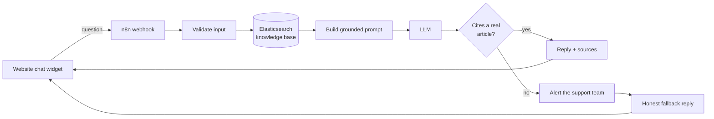

# AI Customer Support Chatbot

**An n8n automation that answers customer questions from a company's own help articles, cites its sources, and alerts a human when it doesn't know.**

Built with n8n, Elasticsearch and an OpenAI-compatible LLM (tested with Google Gemini). Designed, built and debugged by **BILAL EZNAKI**.

## The problem

Small businesses answer the same questions again and again: shipping times, refunds, opening hours, password resets. A generic chatbot is risky because it invents answers. A customer who is told a wrong refund policy is worse off than one who gets no answer.

## The solution

A chatbot that only answers from the company's **own** knowledge base, and says so honestly when it can't:

- Searches the help articles in Elasticsearch, then has an LLM write a short answer **using only those articles**
- Replies in the customer's language and links the **source articles**
- **Refuses to guess**: an answer is accepted only if it cites a real article
- Sends an **alert to the support team** (Discord, Slack or any webhook) with the question and the reason
- Keeps working when a service is down: the customer still gets a clean reply
- Remembers the conversation for follow-up questions, without storing anything on the server

## How it works



A second workflow, the **Article Loader**, lets a non-technical person paste a table from Excel or Google Sheets into a web form to update the knowledge base.

## What's in this repo

```
workflows/
  ai-customer-support-chatbot-v2.json   main chatbot (17 nodes + documentation notes)
  article-loader.json                   paste-a-table loader for the knowledge base
widget/
  chat-widget-demo.html                 single-file website chat widget
sample-data/
  my-articles-template.csv              example articles
docs/
  SETUP.md                              full setup and configuration guide
```

## Key design decisions

- **Grounded answers.** The model must return JSON naming the article numbers it used. No valid citation means "not answerable", so the bot escalates instead of guessing.
- **One Config node.** Branding, messages, model, limits and escalation are all settings in one place. Nothing needs code changes to rebrand it for a new client.
- **Provider-agnostic.** The LLM call uses the OpenAI chat format, so the model and base URL can be switched (OpenAI, Gemini, OpenRouter and others).
- **Failure-tolerant.** Timeouts on every external call, plus retries on the search, AI and alert calls. If search or the model fails, the customer gets a polite reply and the team gets an alert saying why.
- **Safe by default.** Input length limits, prompt-injection guards, escaped alert messages (no `@channel` pings), no secrets in the workflow file, successful executions not stored.

## Tech stack

n8n (self-hosted in Docker) · Elasticsearch · Google Gemini via its OpenAI-compatible API · JavaScript (n8n Code nodes, chat widget) · Discord webhooks

## Run it locally

1. Start n8n and Elasticsearch with Docker.
2. Import `workflows/ai-customer-support-chatbot-v2.json` into n8n and add your credentials.
3. Load sample articles with the Article Loader (or the command in `docs/SETUP.md`).
4. Open `widget/chat-widget-demo.html` and ask a question.

Details for each step are in [docs/SETUP.md](docs/SETUP.md). No credentials are stored in this repository; you create them inside your own n8n.

## Challenges and what I learned

- **A retired model.** My first model name stopped working because the provider had retired it for new users. I read the API error and switched to the model it named. Model names are settings here, not hard-coded.
- **Slow free-tier responses.** A free plan caused a timeout on one request. I traced it in the node's error output, confirmed that a retry worked, and made sure a failure like this is visible to the team instead of silent. The timeout is a setting that can be raised.
- **Docker networking.** n8n inside Docker can't reach Elasticsearch at `localhost`; it needs `host.docker.internal`.
- **Green ticks aren't proof.** Nodes that call other services can show success while their call failed, so I added explicit failure reasons to every alert.

## Limitations and roadmap

- Search is keyword-based, so it matches words, not meaning. Next step: semantic search for multilingual knowledge bases.
- Runs on my own machine; the next step is hosting it online behind a small proxy so the key stays private.
- Planned channels: WhatsApp and Telegram.

## Work with me

I build n8n automations and AI assistants for small businesses.
Contact: `hokaidobilalobox@gmail.com` · GitHub: `Bilalobox`

## License

MIT, see [LICENSE](LICENSE).
